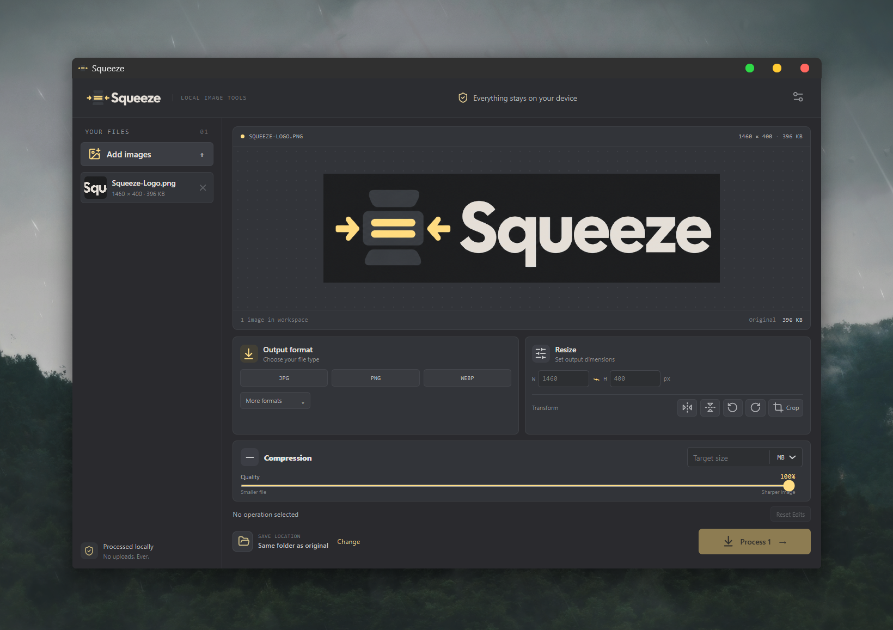

  

# Squeeze

A free, open-source image converter, compressor, and editor for Windows. Everything runs locally, with no uploads or accounts.

  

## Features

- Convert between JPG, PNG, WebP, BMP, GIF, ICO, and TIFF.
- Compress images and specify a target file size.
- Flip, rotate, resize, and crop images.
- Process multiple images at once.
- Preview images before processing.
- Convert, compress, or edit independently.
- Preserve original files.
- Check for updates through GitHub.
- Work completely offline for image processing.

## Download

Download the latest version from [GitHub Releases](https://github.com/eeliyaa/Squeeze/releases/latest).

## Notes

Animated GIF editing and AVIF are not supported yet. GIF support is limited to static images. Target-size compression may not always achieve the requested size.

## License

[MIT License](LICENSE).
